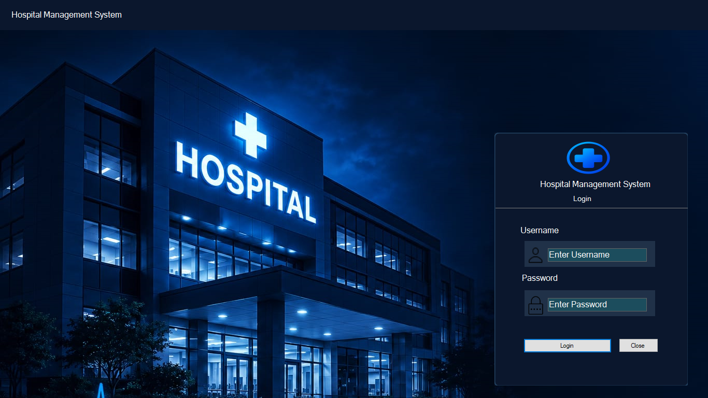

# 🏥 Hospital Management System

A desktop-based **Hospital Management System (HMS)** developed using **C#, Windows Forms, and Microsoft SQL Server** to simplify and manage hospital operations.

## 📌 About the Project

The Hospital Management System is designed to manage essential hospital activities through a user-friendly desktop application. It helps organize patient records, doctor information, appointments, consultation findings, prescriptions, and billing.

The application provides separate login access and workflows for administrators, doctors, and receptionists.

## ✨ Features

- 🔐 **Login System** — User authentication and role-based navigation.
- 🛡️ **Admin Management** — Manage doctor and receptionist accounts.
- 🧑‍🤝‍🧑 **Patient Management** — Register patients and maintain patient records.
- 👨‍⚕️ **Doctor Management** — Store and manage doctor information.
- 📅 **Appointment Management** — Schedule and track patient appointments.
- 🩺 **Consultation Findings** — Record symptoms, diagnosis, and treatment.
- 💊 **Prescription Management** — Manage prescribed medicines.
- 🧾 **Billing** — Manage patient bills.
- 📋 **Patient History** — View patient-related history and information.
- 📊 **Dashboard** — Display relevant hospital activity statistics.

## 🛠️ Technologies Used

| Technology | Purpose |
|---|---|
| C# | Application programming |
| Windows Forms | Desktop user interface |
| Microsoft SQL Server | Database management |
| ADO.NET | Database connectivity |
| Visual Studio | Development environment |

## 📸 Application Screenshots

### 🔐 Login Page



### 🛡️ Admin Dashboard


### 👨‍⚕️ Doctor Dashboard


### 🧑‍💼 Receptionist Dashboard


### 🩺 Manage Doctors


### 👥 Manage Receptionists


## 🗄️ Database

This project uses **Microsoft SQL Server** to store and manage hospital information.

The database script is provided in `HMS_Database.sql`. It is intended to help recreate the database structure required by the application.

**Database setup:**

1. Open SQL Server Management Studio (SSMS).
2. Connect to your SQL Server instance.
3. Create the required database, such as `hospitaldb`, if the script does not create it.
4. Open `HMS_Database.sql` and execute the script.
5. Verify that the required tables have been created.

> Note: Ensure the SQL script includes the required table definitions and relationships. Update your connection string to match your SQL Server configuration.

## 🚀 How to Run the Project

1. Download or clone this repository.
2. Open the `.sln` solution file in Visual Studio.
3. Set up the database using the instructions above.
4. Update the database connection string in the application.
5. Build the solution.
6. Run the application from Visual Studio.

## 📂 Project Structure

```text
hospital-management-system/
├── hms.sln
├── hms/
├── HMS_Database.sql
├── login.png
├── admin-dashboard.png
├── doctor-dashboard.png
├── receptionist-dashboard.png
├── manage-doctor.png
├── manage-receptionist.png
└── README.md
```

*The structure above is an example. Actual files and folders may differ depending on what is uploaded to the repository.*

## 🔒 Data and Privacy

This project is intended for educational and demonstration purposes.

- Do not upload real patient records or confidential information.
- Do not store real passwords or sensitive credentials in the repository.
- Use fictional sample data when demonstrating the application.

## 🎯 Project Objective

The objective of this project is to apply C# desktop application development, database connectivity, and SQL Server management concepts to build a system for handling common hospital operations.

## 👨‍💻 Developer

**Ajin Ravin R**

